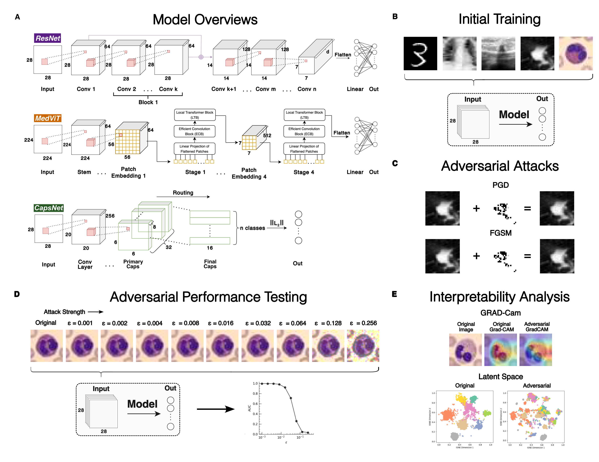

# On the Adversarial Robustness of Medical Capsule Networks

## Overview

This repository trains and evaluates ResNet-18, ResNet-50, MedViT,
DR-CapsNet, and BP-CapsNet on MNIST and four MedMNIST classification datasets:
BreastMNIST, PneumoniaMNIST, NoduleMNIST3D, and BloodMNIST. It provides
reproducible workflows for clean training, white-box adversarial evaluation,
cross-model transfer attacks, adversarial training, inference benchmarking,
and clean/adversarial interpretability analysis.



## Contents

1. [Installation](#installation)
2. [Repository structure](#repository-structure)
3. [Data](#data)
4. [Training](#training)
5. [Adversarial evaluation](#adversarial-evaluation)
6. [PGD adversarial training](#pgd-adversarial-training)
7. [Interpretability](#interpretability)
8. [Inference benchmarking](#inference-benchmarking)
9. [Generated artifacts](#generated-artifacts)
10. [References](#references)

## Installation

Clone the repository and create the Conda environment:

```bash
git clone https://github.com/Aneja-Lab-Yale/Aneja-Lab-Public-Adversarial-CapsNet
cd Aneja-Lab-Public-Adversarial-CapsNet
conda env create -f adversarial_env.yml
conda activate adv
```

Run commands from the repository root. Training and evaluation scripts create
their output directories as needed. Dataset downloads are stored under
`data/`.

## Repository structure

The source tree is organized as follows:

```text
.
├── models/                         # model architectures
├── scripts/
│   ├── experiments/                # training and attack implementations
│   ├── runners/                    # multi-dataset/model workflow launchers
│   ├── interpretability/           # Grad-CAM and latent-space workflows
│   ├── analysis/                   # metric summaries and exports
│   └── benchmarking/               # inference timing worker and runner
├── loss.py                         # shared model losses
├── utils.py                        # transforms and evaluators
└── adversarial_env.yml             # Conda environment
```

Training and analysis create runtime directories such as `data/`,
`checkpoints/`, `logs/`, `adv_output/`, `transfer_attack_data/`,
`gradcam_data/`, `latent_space/`, and `inference_benchmarks/`. These contain
downloaded data or generated artifacts rather than source code.

## Data

MNIST is downloaded through `torchvision.datasets`. MedMNIST datasets are
downloaded through the `medmnist` package. Dataset descriptions and licenses
are available from [MedMNIST](https://medmnist.com/).

The training runners download missing datasets by default. Individual
experiment commands can use `--download` when the data are not already
available.

## Training

### MNIST

Train all five architectures sequentially:

```bash
python scripts/runners/train_all_mnist.py
```

The runner trains each model for 100 epochs by default, writes logs under
`logs/mnist_training/`, and skips an existing checkpoint unless `--force` is
used. Model selection uses validation AUC, and the held-out test set is
evaluated after training with the best-validation model.

Common options include:

```bash
# Train selected models for a shorter run
python scripts/runners/train_all_mnist.py \
  --models resnet18 caps bpcaps \
  --epochs 10 \
  --batch-size 32

# Show the commands without starting training
python scripts/runners/train_all_mnist.py --dry-run

# Retrain models even when checkpoints exist
python scripts/runners/train_all_mnist.py --force
```

### MedMNIST

Train all five architectures on the four selected medical datasets:

```bash
python scripts/runners/train_all_medmnist.py
```

Use `--datasets` and `--models` to select a subset. Downloads are enabled by
default and can be disabled with `--no-download`. The runner automatically
uses 224x224 inputs and the corresponding `_224` checkpoint name for MedViT.

For example:

```bash
python scripts/runners/train_all_medmnist.py \
  --datasets breastmnist pneumoniamnist \
  --models resnet18 caps bpcaps \
  --epochs 10
```

Checkpoints are written under `checkpoints/`.

## Adversarial evaluation

All model inputs are normalized to `[-1, 1]`, and reported attack epsilon
values use that normalized coordinate system. For example, epsilon `0.064`
corresponds to approximately `8/255` in the original `[0, 1]` pixel space.
Attacks optimize classification cross-entropy for every architecture; capsule
reconstruction loss is excluded from adversarial evaluation.

### FGSM and PGD sweeps

Run the standard nine-epsilon medical sweeps:

```bash
python scripts/runners/medical_fgsm_sweep.py
python scripts/runners/medical_pgd_sweep.py
```

The default epsilon sequence is:

```text
0.001, 0.002, 0.004, 0.008, 0.016, 0.032, 0.064, 0.128, 0.256
```

Results are written under `adv_output/fgsm/` and `adv_output/pgd/`; logs are
written under `logs/`. The runners validate completed outputs and support
`--force`, `--dry-run`, subset selection, and `--continue-on-error`.

For a custom PGD configuration, invoke the experiment directly. This example
runs epsilon `0.016` with 100 iterations and five random restarts:

```bash
python scripts/experiments/experiments_medmnist.py \
  --data_flag breastmnist \
  --model_flag caps \
  --num_epochs 0 \
  --model_path checkpoints/caps_breastmnist_best_model.pth \
  --experiment sensitivity \
  --attack_type pgd \
  --attack_epsilons 0.016 \
  --pgd_max_iter 100 \
  --pgd_num_random_init 5
```

### AutoAttack

Run AutoAttack at epsilon `0.032` for every medical dataset/model pair:

```bash
python scripts/runners/medical_autoattack_runner.py
```

Use `--epsilon` to select another budget.

### PGD transfer attacks

Generate PGD source sets and evaluate each set against the other four
architectures:

```bash
python scripts/runners/pgd_transfer_runner.py
```

The default epsilon is `0.016`. MNIST uses a deterministic 1,000-image subset;
the medical datasets use their complete test sets. Source archives are stored
under `transfer_attack_data/`, metrics under `adv_output/transfer/`, and logs
under `logs/pgd_transfer/`.

### CW-L2

Run CW-L2 on a single checkpoint through the main experiment entry point:

```bash
python scripts/experiments/experiments_medmnist.py \
  --data_flag breastmnist \
  --model_flag caps \
  --num_epochs 0 \
  --model_path checkpoints/caps_breastmnist_best_model.pth \
  --experiment sensitivity \
  --attack_type cw
```

The standard CW-L2 configuration uses 500 optimization iterations and ten
binary-search steps. It attacks initially correct examples and records
adversarial accuracy, AUC, attack success rate, failures, and successful-attack
L2 statistics. L2 distances are reported in the model-input `[0, 1]` pixel
space.

For reproducible shared or model-specific cohorts, use the budgeted runner:

```bash
python scripts/runners/experiments_cw_budgeted.py \
  --datasets bloodmnist \
  --models resnet18 resnet50 caps bpcaps \
  --selection shared-correct \
  --num-cases 300 \
  --initial-const 0.01 \
  --output-dir adv_output/cw/blood_shared300 \
  --download
```

Sweep the CW trade-off constant for CapsNet or BP-CapsNet with:

```bash
python scripts/runners/experiments_cw_const_sweep.py \
  --model caps \
  --initial-const 0.01 0.1 1 10
```

## PGD adversarial training

MedMNIST training supports label-aware, in-loop PGD adversarial examples:

```bash
python scripts/experiments/experiments_medmnist.py \
  --data_flag breastmnist \
  --model_flag resnet18 \
  --num_epochs 100 \
  --download \
  --adversarial_training \
  --adv_eps 0.016 \
  --adv_steps 7
```

`--adv_step_size` defaults to `adv_eps / 4`. Use `--adv_clean_weight` to mix
clean and adversarial losses, or `--no_adv_random_start` to disable the random
start. Adversarially trained checkpoints use a distinct
`_pgd_at_eps_<epsilon>_best_model.pth` suffix and record their training
configuration.

## Interpretability

Interpretability workflows consume saved PGD source archives produced by the
transfer runner.

### Latent-space embeddings

Generate clean/adversarial latent features and joint t-SNE embeddings:

```bash
python scripts/interpretability/generate_tsne_embeddings.py \
  --epsilon 0.016 \
  --device cuda
```

Results are stored under
`latent_space/pgd_eps_0.016/<dataset>/<model>/`. Use `--skip-tsne` to extract
features without fitting t-SNE or `--overwrite` to replace completed outputs.

### Grad-CAM

Generate paired clean/adversarial Grad-CAM maps:

```bash
python scripts/interpretability/generate_gradcam_maps.py \
  --epsilon 0.016 \
  --device cuda
```

Results are stored under
`gradcam_data/pgd_eps_0.016/<dataset>/<model>/gradcam_maps.npz`. Summarize
clean/adversarial top-pixel overlap with:

```bash
python scripts/analysis/calculate_gradcam_similarity.py --epsilon 0.016
```

## Inference benchmarking

Benchmark every available dataset/model checkpoint and create a CSV summary:

```bash
python scripts/benchmarking/inference_benchmark_runner.py
```

Use `--datasets`, `--models`, `--batch-size`, and `--device` to restrict or
configure a run. Results are written under `inference_benchmarks/`, with logs
under `logs/inference_benchmarks/`.

## Generated artifacts

Downloaded datasets, checkpoints, logs, attack archives, numerical results,
benchmark results, and generated figures are runtime artifacts. They are not
required to understand or install the source code and may be omitted from a
source-only distribution. The relevant directories are:

```text
data/
checkpoints/
logs/
adv_output/
transfer_attack_data/
gradcam_data/
latent_space/
inference_benchmarks/
figs/                  # except intentionally published static figures
```

## References

- Lei, Y., Wu, Z., Li, Z., Yang, Y. and Liang, Z. (2023). BP-CapsNet: An
  image-based deep learning method for medical diagnosis. *Applied Soft
  Computing*, 146, 110683.
- Manzari, O. N., Ahmadabadi, H., Kashiani, H., Shokouhi, S. B. and Ayatollahi,
  A. (2023). MedViT: A robust vision transformer for generalized medical image
  classification. *Computers in Biology and Medicine*, 157, 106791.
- Torres, J. and Gildenblat, J. (2021). pytorch-grad-cam: Gradient-weighted
  class activation mapping in PyTorch.
- Yang, J., Shi, R., Wei, D., Liu, Z., Zhao, L., Ke, B., Pfister, H. and Ni, B.
  (2023). MedMNIST v2—A large-scale lightweight benchmark for 2D and 3D
  biomedical image classification. *Scientific Data*.
